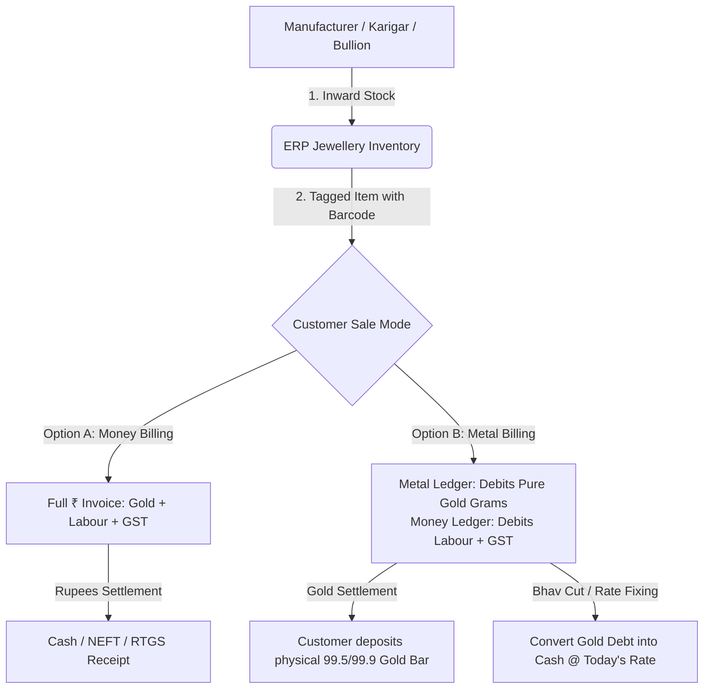

# 💎 Jewellery Wholesale ERP — Complete Workflow & Testing Guide
> **Client:** Jewellery Wholesaler, Pune, India  
> **System Architecture:** Next.js App Router, PostgreSQL, Prisma, Better Auth, Decimal.js Precision Engine  
> **File Version:** 1.0.0

---

## 📑 Table of Contents
1. [The Wholesale Mental Model: How Jewellery Accounting Actually Works](#1-the-wholesale-mental-model)
2. [Weight & Purity Math Explained](#2-weight--purity-math-explained)
3. [The End-to-End Wholesale Lifecycle](#3-the-end-to-end-wholesale-lifecycle)
4. [Step-by-Step Hands-On Testing Guide](#4-step-by-step-hands-on-testing-guide)
   - [Step 0: Start Clean & Authenticate](#step-0-start-clean--authenticate)
   - [Step 1: Create a Customer Profile](#step-1-create-a-customer-profile)
   - [Step 2: Add Inventory Stock (Plain & Studded)](#step-2-add-inventory-stock)
   - [Step 3: Test Sale A — Money Billing (Rupees Invoice)](#step-3-test-sale-a--money-billing)
   - [Step 4: Test Sale B — Metal + Charges Billing (Gold Return)](#step-4-test-sale-b--metal--charges-billing)
   - [Step 5: Test Settlements (Gold Receipt, Cash & Rate Fixing)](#step-5-test-settlements)
   - [Step 6: Print Wholesale A4 Invoice](#step-6-print-wholesale-a4-invoice)
5. [Summary of Active vs Upcoming Modules](#5-summary-of-active-vs-upcoming-modules)

---

## 1. The Wholesale Mental Model

Retail jewellery software (like for consumers walking into a showroom) is simple: 
> *Customer selects a ring &rarr; pays in Rupees &rarr; takes receipt.*

**Wholesale Jewellery is fundamentally different.** Wholesalers sell in bulk to retail jewellers. Because gold prices fluctuate hourly, most wholesale transactions **never sell gold for cash directly**. Instead, gold is loaned and returned as physical gold, while only the artisan's labour (making charge) is paid in rupees.

### The 4 Parallel Accounts
In this ERP, every jewellery item and customer maintains 4 independent layers:
```
┌─────────────────────────────────────────────────────────────────┐
│ 1. Physical Stock     │ Gross weight & tag count in safe        │
│ 2. Fine Gold Ledger   │ 24K Pure Gold balance (grams, 4 dec)    │
│ 3. Money Ledger       │ Cash / Bank receivables (₹, 2 dec)      │
│ 4. Stone / Diamond    │ Carats, piece count & stone value (₹)   │
└─────────────────────────────────────────────────────────────────┘
```
> **Golden Rule of Wholesale Accounting:**  
> **Never mix Gold Grams with Cash Rupees.** A customer can owe you `50.0000 g` of pure gold and simultaneously owe you `₹25,000` for making charges.

---

## 2. Weight & Purity Math Explained

When you weigh an ornament on the scale, you get the **Gross Weight**. But a customer will never pay gold value for stones or wax!

### 1. Net Weight Formula
$$\text{Net Weight} = \text{Gross Weight} - \text{Stone Weight} - \text{Other/Wax Weight}$$

* **Example:**
  - Scale reads: `35.500 g` (Gross)
  - Studded Cubic Zirconia: `2.000 g` (Stone)
  - Enamel / Thread: `0.500 g` (Other)
  - **Net Weight:** $35.500 - 2.000 - 0.500 = \mathbf{33.000\text{ g}}$

### 2. Fine Metal (24K Pure Gold) Formula
$$\text{Fine Metal (g)} = \text{Net Weight} \times \frac{\text{Touch (Purity \%)}}{100}$$

* **Touch by Karat:**
  - **24K (99.9% Pure):** $\text{Touch} = 99.9$
  - **22K / 916 (Standard Hallmark):** $\text{Touch} = 91.6$
  - **18K / 750 (Diamond Jewellery):** $\text{Touch} = 75.0$

* **Example for 22K (91.6%):**
  $$\text{Fine Gold} = 33.000 \times \frac{91.6}{100} = \mathbf{30.2280\text{ g}}$$
  *(The wholesaler is holding exactly 30.2280 grams of pure 24K gold).*

---

## 3. The End-to-End Wholesale Lifecycle



### How the stages connect:
1. **Manufacturer &rarr; Wholesaler (Purchases / Stock Inward):**
   - You either purchase ready jewellery from a manufacturer or give raw gold to a *karigar* (artisan) and receive finished bangles/necklaces.
   - When entered into the ERP, the items are given a unique **Tag/Barcode** (`T0001`, `T0002`...) and placed into **Available Inventory**.
2. **Wholesaler &rarr; Retailer (Sales Billing):**
   - A retail jeweller from Pune visits you and buys 5 necklaces.
   - You bill them either in **Money Mode** or **Metal Mode**.
3. **Settlement (Receipts):**
   - Retailer brings 50g of 24K gold coins/bars next week to clear their gold ledger.
   - Retailer pays making charges via RTGS/NEFT to clear their money ledger.

---

## 4. Step-by-Step Hands-On Testing Guide

Follow these steps directly in your browser at `http://localhost:3000`.

---

### Step 0: Start Clean & Authenticate
1. Open your terminal in `jewel-erp` and run:
   ```bash
   npm run db:clean
   ```
   *(Wipes previous test orders and leaves pure master data).*
2. Open **[http://localhost:3000/login](http://localhost:3000/login)** in your browser.
3. Sign in with:
   - **Email:** `owner@demo.com`
   - **Password:** `ChangeMe@123`

---

### Step 1: Create a Customer Profile
Go to **Customers** &rarr; **[+ Add Customer](http://localhost:3000/customers/new)**:

| Field | Value to Enter | Reason |
| :--- | :--- | :--- |
| **Business Name** | `Shree Ganesh Jewellers` | Retailer business name |
| **Contact Person** | `Ramesh Patil` | Owner / Buyer |
| **Phone** | `9822012345` | Contact number |
| **City / State** | `Pune, Maharashtra` | Local customer |
| **GSTIN** | `27AAAAA0000A1Z5` | State code `27` (MH) triggers **CGST (1.5%) + SGST (1.5%)** |
| **Credit Limit** | `₹5,00,000` | Credit control limit |
| **Default Billing Mode** | `Metal + Charges (Metal Billing)` | Wholesale default |
| **Default Making Rate** | `₹450 / gram` | Customer's agreed labour charge |

Click **Save Customer**.

---

### Step 2: Add Inventory Stock
Go to **Inventory** &rarr; **[+ Add Stock Item](http://localhost:3000/inventory/new)**:

#### Item 1: Plain 22K Gold Chain
- **Design Number:** `CH-1001`
- **Tag / Item Code:** `T0001`
- **Name:** `22K Hollow Rope Chain`
- **Category:** `Chains`
- **Purity:** `22K (91.6% Touch)`
- **Gross Weight:** `24.500 g`
- **Stone Weight:** `0.000 g`
- **Other Weight:** `0.000 g`
- **Observation:** Notice the live calculation preview:
  - $\text{Net Weight} = \mathbf{24.500\text{ g}}$
  - $\text{Fine Gold} = 24.500 \times 0.916 = \mathbf{22.4420\text{ g}}$
- Click **Save Item**.

#### Item 2: Studded 22K Designer Necklace
- **Design Number:** `NC-2050`
- **Tag / Item Code:** `T0002`
- **Name:** `22K Antique Floral Necklace (Ruby & CZ)`
- **Category:** `Necklaces`
- **Purity:** `22K (91.6% Touch)`
- **Gross Weight:** `48.800 g`
- **Stone Weight:** `3.200 g` *(Deducted!)*
- **Other Weight:** `0.600 g` *(Wax/Thread deducted!)*
- **Observation:** Notice the live calculation:
  - $\text{Net Weight} = 48.800 - 3.200 - 0.600 = \mathbf{45.000\text{ g}}$
  - $\text{Fine Gold} = 45.000 \times 0.916 = \mathbf{41.2200\text{ g}}$
- Click **Save Item**.

*(Both items are now live on your stock dashboard at [http://localhost:3000/inventory](http://localhost:3000/inventory)).*

---

### Step 3: Test Sale A — Money Billing (Rupees Invoice)
*Use this when a customer wants a traditional full cash/rupee invoice.*

1. Go to **Sales** &rarr; **[+ New Sale](http://localhost:3000/sales/new)**.
2. **Customer:** Select `Shree Ganesh Jewellers`.
3. **Billing Mode:** Select **Money Billing (₹)**.
4. **Market Gold Rate:** Defaults to today's rate (e.g. `₹7,250 / gram`).
5. **Add Item:** In the Item Code column, type or select `T0001` (`CH-1001`).
   - Gross: `24.500 g`
   - Net: `24.500 g`
   - Making Type: `Per Gram` @ `₹450 / g` = `₹11,025.00`
   - Gold Value: $24.500 \times ₹7,250 = \mathbf{₹1,77,625.00}$
   - Taxable Subtotal: $₹1,77,625 + ₹11,025 = \mathbf{₹1,88,650.00}$
   - GST (3% = 1.5% CGST + 1.5% SGST): $₹1,88,650 \times 0.03 = \mathbf{₹5,659.50}$
   - **Grand Total:** $\mathbf{₹1,94,310.00}$
6. Click **Post & Generate Invoice**.
7. Observe: Stock `T0001` changes status to **SOLD**. Customer's money ledger is debited **₹1,94,310**.

---

### Step 4: Test Sale B — Metal + Charges Billing (Wholesale Gold Return)
*Use this for standard wholesale: the customer returns raw gold and only pays labour.*

1. Go to **Sales** &rarr; **[+ New Sale](http://localhost:3000/sales/new)**.
2. **Customer:** Select `Shree Ganesh Jewellers`.
3. **Billing Mode:** Select **Metal + Charges (Gold Return)**.
4. **Add Item:** Select `T0002` (`NC-2050`).
   - Net Weight: `45.000 g`
   - Touch: `91.6%`
   - **Fine Gold Owed:** $\mathbf{41.2200\text{ g}}$ *(Pure 24K)*
   - Making Charge: $45.000\text{ g} \times ₹450 = \mathbf{₹20,250.00}$
   - GST (3% on Labour): $₹20,250 \times 0.03 = \mathbf{₹607.50}$
   - **Invoice Cash Due:** $\mathbf{₹20,858.00}$
5. Click **Post & Generate Invoice**.
6. **Accounting Result:**
   - **Gold Ledger:** Debited **`+41.2200 g`** (Customer owes you pure gold).
   - **Money Ledger:** Debited **`+₹20,858.00`** (Customer owes you labour + tax).

---

### Step 5: Test Settlements (Gold Receipt, Cash & Rate Fixing)
Go to **Customers** &rarr; Click on **`Shree Ganesh Jewellers`**:

#### 1. Customer Pays Gold (Gold Receipt)
*The retailer drops off a 99.5 purity gold bar.*
- Click **[+ Receive Metal]** on the customer overview page.
- **Physical Weight:** `40.000 g`
- **Touch / Purity:** `99.5%`
- System calculates: $\text{Fine Gold Received} = 40.000 \times 0.995 = \mathbf{39.8000\text{ g}}$.
- Reference: `Bar #9842 from Kundan Refinery`.
- Click **Post Gold Receipt**.
- **Result:** Customer's fine gold balance drops from `41.2200 g` to **`1.4200 g`**.

#### 2. Customer Pays Labour (Cash / Bank Receipt)
*The retailer pays the ₹20,858 making charges via RTGS.*
- Click **[+ Receive Cash / Bank]**.
- **Amount:** `₹20,858`
- **Mode:** `RTGS` (or `UPI`, `NEFT`, `CASH`).
- **Reference:** `UTR #HDFC9482048`.
- Click **Post Receipt**.
- **Result:** Customer's cash balance drops to zero!

#### 3. Rate Fixing (Bhav Cut)
*Customer has `1.4200 g` fine gold remaining unpaid, and decides to lock in today's gold rate and convert it into cash.*
- Click **[Fix Rate / Bhav Cut]**.
- **Fine Weight to Fix:** `1.4200 g`.
- **Agreed Rate:** `₹7,300 / gram`.
- Amount computed: $1.4200 \times ₹7,300 = \mathbf{₹10,366.00}$.
- Click **Confirm Rate Fix**.
- **Result:**
  - Fine Gold balance becomes **`0.0000 g`** (fully cleared!).
  - Money balance becomes **`₹10,366.00`** (now payable in cash).

---

### Step 6: Print Wholesale A4 Invoice
1. Go to **Sales** &rarr; Click on any completed invoice (e.g. `SALE/26-27/0002`).
2. The page renders the clean, **Wholesale A4 Invoice format** designed specifically for Indian jewellery businesses:
   - Full GST breakdown (HSN `7113`, CGST `1.5%`, SGST `1.5%`).
   - Separate columns for Gross Weight, Stone Deduction, Net Weight, Touch %, and Pure Gold.
   - Dual settlement summary showing both Fine Metal Owed and Amount in ₹.
3. Click **Print / PDF** to view the preview or print to thermal / A4 sheet.

---

## 5. Summary of Active vs Upcoming Modules

| Module | Status | Features Available Right Now |
| :--- | :--- | :--- |
| **Customer Master** | ✅ **Active** | Full KYC, GSTIN validation, credit limits, custom making rates, dual balances |
| **Inventory Stock** | ✅ **Active** | Live Gross &rarr; Net &rarr; Fine gold engine, tag barcodes, HUID, categories |
| **Sales Billing** | ✅ **Active** | Fast keyboard entry, Money vs Metal billing, real-time GST split, A4 invoice |
| **Ledgers & Settlements**| ✅ **Active** | Physical Gold Receipts, Cash/Bank Receipts, Bhav Cut / Rate Fixing, Reversals |
| **Daily Metal Rates** | ✅ **Active** | Daily 24K, 22K, 18K rate board |
| **Purchases & Karigar** | ⏳ *Next Phase* | Recording raw bullion issuance to karigar, receiving finished lots with loss/wastage |
| **Approval / Memo** | ⏳ *Next Phase* | Giving jewellery to retailers for inspection without generating a tax invoice |
